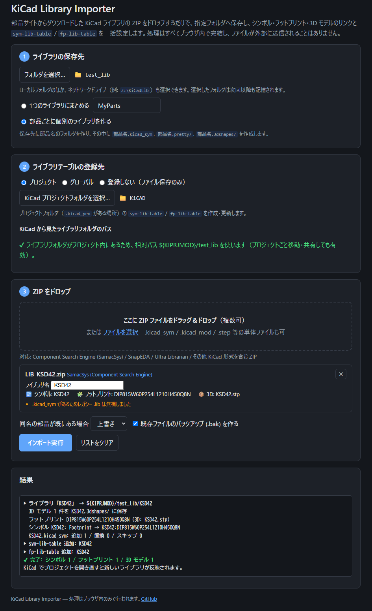

# KiCad Library Importer

部品サイトからダウンロードした KiCad ライブラリの ZIP を**ドラッグ＆ドロップするだけ**で、

1. 任意のローカル / ネットワークフォルダへ展開・保存
2. シンボル → フットプリント、フットプリント → 3D モデルのリンクを自動で書き換え
3. `sym-lib-table` / `fp-lib-table` へ登録（**プロジェクト**か**グローバル**かを選択）

までを一括で行う Web ツールです。インストール不要で、処理はすべてブラウザ内で完結します（ファイルは外部に送信されません）。

## 使い方

1. Chrome または Edge（PC 版）でページを開く
2. **ライブラリの保存先**フォルダを選ぶ（ネットワークドライブも可）。シンボル・フットプリント・3D モデルを別々のフォルダに保存することもできます
3. **ライブラリテーブルの登録先**を選ぶ
   - **プロジェクト**: KiCad プロジェクトフォルダを選択。保存先がプロジェクト内なら `${KIPRJMOD}` 相対パスを自動で使います
   - **グローバル**: KiCad で登録するライブラリ名とパスを表示（初回のみ登録が必要）。Linux などでは設定フォルダを選んで直接更新も可能
   - **登録しない**: ファイル保存のみ
4. 必要に応じて「KiCad から見たライブラリフォルダのパス」を入力（後述）
5. ZIP をドロップして **インポート実行**

選択したフォルダと設定はブラウザに記憶されるので、2 回目以降は ZIP をドロップして実行するだけです。

## 保存される構成

**1 つのライブラリにまとめる**（既定、ライブラリ名は変更可）

```
<保存先>/
  MyParts.kicad_sym        … 全部品のシンボルを追記
  MyParts.pretty/          … フットプリント
  MyParts.3dshapes/        … 3D モデル (STEP/WRL)
  MyParts_legacy.lib/.dcm  … KiCad 5 形式しか無い部品のみ
```

テーブルへの登録は初回だけで、以降は同じライブラリに部品が追記されていきます。

**保存先を個別に指定する** にチェックすると、シンボル・フットプリント・3D モデルの保存先フォルダと、それぞれの「KiCad から見たパス」を別々に指定できます。

```
<シンボルの保存先>/MyParts.kicad_sym
<フットプリントの保存先>/MyParts.pretty/     … 選んだフォルダ自体が xxx.pretty なら、そこへ直接保存（ライブラリ名は xxx）
<3D モデルの保存先>/                          … フォルダ直下に保存（部品ごとモードでは 部品名/ の下）
```

**部品ごとに個別のライブラリを作る** を選ぶと `<保存先>/<部品名>/` に同じ構成で作成し、部品ごとにテーブル登録します。

## リンクの書き換え内容

- シンボルの `Footprint` プロパティ → `ライブラリ名:フットプリント名`
- フットプリントの `(model ...)` → `<KiCad から見たパス>/<ライブラリ名>.3dshapes/<ファイル名>`
  - 元のパスが部品サイト側の絶対パスでも、ファイル名で照合して置き換えます
  - モデル参照が無いフットプリントには、ZIP 内の 3D モデルを追加します（位置・回転は要確認）
- 名前が同じで 3D モデルが異なるフットプリント（例: 同じ SOIC-8 パッケージの別部品）は `フットプリント名_部品名` として別保存し、シンボル側もそちらを参照させます
- 同名部品がある場合は「上書き / スキップ」を選択できます。上書き前のファイルは `.bak` として残します（オプション）

## KiCad から見たライブラリフォルダのパス

ブラウザのセキュリティ仕様上、選択したフォルダの**絶対パスは取得できません**。そのため、テーブルや 3D モデルに書き込むパスを次のどちらかで決めます。

- **プロジェクト登録で、保存先がプロジェクトフォルダの中**: 自動で `${KIPRJMOD}/...` を使います（入力不要）
- **それ以外**: パスを入力します
  - 例: `D:/KiCadLib`、`//nas/share/KiCadLib`
  - おすすめ: KiCad の「設定 → パスを設定」で環境変数（例 `MY_KICAD_LIB`）を登録し、`${MY_KICAD_LIB}` と入力。PC ごとにドライブ文字が違ってもチームで共有できます

## グローバルテーブルについて

Chrome / Edge は、Windows の `AppData` や macOS の `Library` のようなシステムフォルダを、Web ページから選択できないようにしています。グローバルの `sym-lib-table` / `fp-lib-table` はこの中にあるため、ブラウザからは直接書き換えられません。

そこでグローバル登録では、次の手順を使います（おすすめ）。

1. インポートすると、登録するライブラリ名・パス・形式が表で表示されます
2. KiCad の「設定 → シンボルライブラリを管理 / フットプリントライブラリを管理」→「グローバルライブラリ」タブで「＋」を押し、表の内容をコピーして入力します
3. 「登録しました」を押すと記録され、次回から同じライブラリへの追加では案内が出ません

「1 つのライブラリにまとめる」設定なら、**この登録は最初の 1 回だけ**です。以降は部品が同じライブラリファイルに追記されるだけなので、KiCad を開き直すだけで新しい部品が使えます。

そのほかの方法:

- 既存のテーブルファイルを読み込むと、更新版をダウンロードできます。KiCad 終了後に設定フォルダへ上書きしてください
- テーブルに直接貼り付ける追記行も表示します
- Linux など設定フォルダを選べる環境では、「設定フォルダを選択して直接更新する」も使えます

| OS | 設定フォルダ |
| --- | --- |
| Windows | `%APPDATA%\kicad\<バージョン>\` |
| macOS | `~/Library/Preferences/kicad/<バージョン>/` |
| Linux | `~/.config/kicad/<バージョン>/` |

グローバル登録まで完全に自動化するには、ブラウザの外で動くもの（Tauri などのデスクトップアプリ、または KiCad のプラグイン）が必要です。

## 動作確認結果

Component Search Engine (SamacSys) からダウンロードした `LIB_KSD42.zip` を、実機の Chrome で取り込んだ結果です。

- 設定: 部品ごとに個別のライブラリを作る / テーブルの登録先はプロジェクト / 保存先はプロジェクト内の `test_lib`
- `${KIPRJMOD}/test_lib` の相対パスが自動で設定されました
- シンボル `KSD42` の Footprint が `KSD42:DIP815W60P254L1210H450Q8N` に書き換わりました
- フットプリントの 3D モデルが `KSD42.3dshapes/KSD42.stp` に紐付きました
- `sym-lib-table` / `fp-lib-table` に `KSD42` が追加されました



## 対応している部品サイト

| サイト | 状態 |
| --- | --- |
| [Component Search Engine](https://componentsearchengine.com/) (SamacSys / Mouser・RS 等の ECAD モデル) | 主対象（実機で動作確認済み） |
| SnapEDA | 対応（実データでの検証は未実施） |
| Ultra Librarian | 対応（実データでの検証は未実施） |
| その他 | ZIP 内の `.kicad_sym` / `.lib` / `.kicad_mod` / `.step` / `.stp` / `.wrl` を汎用的に処理 |

- `.kicad_sym` と旧形式 `.lib` の両方がある場合は `.kicad_sym` を優先します
- ZIP の中の ZIP も展開します
- ZIP を使わず `.kicad_sym` などのファイルを直接ドロップすることもできます
- KiCad 4/5 の旧形式フットプリント `.mod` には対応していません

## 動作環境

- Google Chrome / Microsoft Edge 86 以降（PC 版）
  - [File System Access API](https://developer.mozilla.org/docs/Web/API/File_System_API) を使うため、Firefox・Safari ではフォルダへの保存ができません
- KiCad 6 以降（7 で読み込みを確認済み）

## 開発

外部ライブラリを使わない素の HTML / JavaScript (ES Modules) です。ビルドは不要で、静的ファイルとして配信すれば動きます（GitHub Pages など）。ローカルで試すときは `npx http-server` などで配信してください（`file://` では ES Modules が読み込めません）。

```
index.html / style.css
js/app.js       UI
js/importer.js  フォルダへの書き込み・テーブル更新
js/kicad.js     KiCad ファイルの解析・書き換え・マージ
js/sexpr.js     S 式パーサ
js/zip.js       ZIP 展開（ブラウザ標準の DecompressionStream を使用）
```

テスト（Playwright + Chrome、Origin Private File System 上で実際の書き込みまで検証）:

```
npm install
npm run fixtures
npm test          # Chrome の場所を指定する場合は CHROME=/path/to/chrome npm test
```

## ライセンス

MIT
