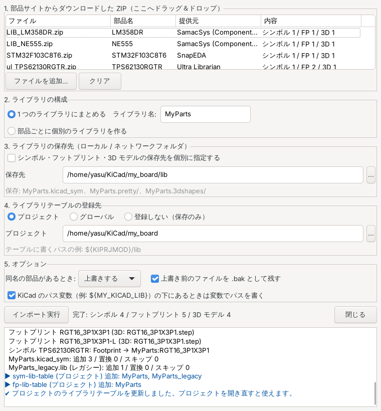

# KiCad Library Importer（KiCad プラグイン版）

Web 版と同じ処理を KiCad の中で動かすプラグインです。ブラウザの制限が無いので、**グローバルの `sym-lib-table` / `fp-lib-table` への登録まで自動**で行えます。



## できること

- 部品サイトの ZIP を画面にドラッグ＆ドロップ（または「ファイルを追加…」）
- 任意のローカル / ネットワークフォルダへ保存
  - 「1 つのライブラリにまとめる」/「部品ごとに個別のライブラリを作る」
  - シンボル・フットプリント・3D モデルの保存先を個別に指定することも可能（フットプリントに `xxx.pretty` を選ぶとそこへ直接保存）
- シンボル → フットプリント、フットプリント → 3D モデルのリンクを書き換え
- ライブラリテーブルへの登録先を選択
  - **プロジェクト**: PCB エディタで開いているボードのフォルダを自動で選択。プロジェクト内なら `${KIPRJMOD}/...` で登録
  - **グローバル**: KiCad の設定フォルダのテーブルを直接更新（手動登録は不要）
  - **登録しない**: 保存とリンクの書き換えのみ
- 同名部品は「上書き / スキップ」を選択、上書き前のファイルは `.bak` で保存
- 保存先が KiCad の「パスを設定」で登録した変数（例 `MY_KICAD_LIB`）の下にあれば、`${MY_KICAD_LIB}/...` の形で登録（チームで共有しやすい）
- 設定は KiCad の設定フォルダの `kicad_lib_importer.json` に保存され、次回も引き継がれます

Web 版で「KiCad から見たパス」を入力していた欄は不要になりました（プラグインはフォルダの実際の場所が分かるため）。

## 対応バージョン

- KiCad 9 / 8（主対象）、7
- PCB エディタの Python プラグイン（`pcbnew.ActionPlugin`）として動きます。回路図エディタからは起動できないため、PCB エディタのツールバーのボタン、または「ツール → 外部プラグイン」から開いてください
- KiCad 9 で導入された新しい IPC API プラグインではなく、KiCad 9 でも引き続き使える従来の Python プラグイン方式です

## インストール

### プラグイン & コンテンツマネージャーから（おすすめ）

1. GitHub の Releases（または Actions の成果物）から `kicad-lib-importer-pcm-<バージョン>.zip` を入手
   - 自分で作る場合: `python3 kicad-plugin/build.py` → `kicad-plugin/dist/` に作成
2. KiCad のメイン画面で「プラグイン & コンテンツマネージャー」→ 左下の「ファイルからインストール…」で ZIP を選択
3. PCB エディタを開き直すとツールバーにボタンが出ます（出ない場合は「ツール → 外部プラグイン → プラグインを更新」）

### 手動で

`kicad-plugin/plugins` フォルダを、KiCad のプラグインフォルダに好きな名前（例 `kicad_lib_importer`）でコピーします。

| OS | プラグインフォルダ（KiCad 9 の例） |
| --- | --- |
| Windows | `%USERPROFILE%\Documents\KiCad\9.0\scripting\plugins\` |
| macOS | `~/Documents/KiCad/9.0/scripting/plugins/` |
| Linux | `~/.local/share/kicad/9.0/scripting/plugins/` |

## 使い方

1. PCB エディタでボードを開き、ツールバーの **KiCad Library Importer** ボタンを押す
2. ZIP を画面にドロップ
3. 保存先・登録先を選んで **インポート実行**
4. 反映
   - **プロジェクト**登録: プロジェクトを開き直す
   - **グローバル**登録: KiCad を再起動する

> **グローバル登録の注意**: KiCad は起動時にグローバルテーブルを読み込み、「ライブラリを管理」画面で変更して OK を押すと、起動時に読み込んだ内容をもとに上書き保存します。インポート後、再起動する前にその画面でライブラリを追加・変更すると今回の登録が消えることがあるので、先に KiCad を再起動してください。上書き前のテーブルは `sym-lib-table.bak` / `fp-lib-table.bak` として残ります。

## KiCad を開かずに使う

同梱の `standalone.py` で、画面だけ、またはコマンドラインで実行できます。KiCad 同梱の Python（Windows は「KiCad コマンドプロンプト」）で動かすと wxPython がそのまま使えます。

```
python standalone.py                                   # 画面を開く
python standalone.py LIB_NE555.zip --dest D:/KiCadLib --scope global
python standalone.py *.zip --dest ./lib --scope project --project .
python standalone.py --help
```

## 開発

```
kicad-plugin/
  metadata.json        PCM 用のパッケージ情報
  build.py             PCM 用 ZIP の作成
  standalone.py        単体起動（GUI / CLI）
  plugins/
    __init__.py        プラグイン登録
    action.py          pcbnew.ActionPlugin
    gui.py             画面（wxPython）
    importer.py        保存・テーブル更新（js/importer.js の移植）
    kicad_lib.py       解析・書き換え・マージ（js/kicad.js の移植）
    sexpr.py           S 式パーサ（js/sexpr.js の移植）
    archive.py         ZIP 展開（入れ子の ZIP 対応）
    kicad_env.py       KiCad のバージョン・設定フォルダ・パス変数の検出
    settings.py        設定の保存
  tests/test_plugin.py
```

テスト（KiCad は不要。Node.js があれば Web 版と同じ入力で同じ出力になることも確認します）:

```
python3 -m unittest discover -s kicad-plugin/tests -v
```

解析・書き換えのロジックを変えるときは、Web 版（`js/kicad.js`）とプラグイン版（`plugins/kicad_lib.py`）の両方を直してください。上のテストで差分が検出されます。
